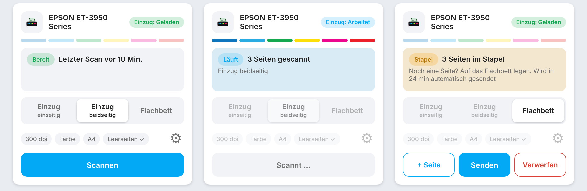

[](https://github.com/ludgerbeckmann/ha_airscan/actions/workflows/validate.yml) [](https://github.com/ludgerbeckmann/ha_airscan/releases/latest) [](https://github.com/ludgerbeckmann/ha_airscan/blob/main/LICENSE)  [](https://github.com/ludgerbeckmann/ha_airscan/issues)

Scannt über eSCL/AirScan direkt aus Home Assistant – vom Flachbett oder Einzug (einseitig/duplex) – und legt die PDFs in Paperless-ngx ab.

[](https://my.home-assistant.io/redirect/hacs_repository/?owner=ludgerbeckmann&repository=ha_airscan&category=integration)



## Was kann sie?

- Scannen vom **Flachbett** (Stapel aus mehreren Seiten) und vom **Einzug** (einseitig oder duplex)
- Eigener, verlustfreier PDF-Aufbau mit korrektem Seitenformat (A4)
- Upload zu **Paperless-ngx** inklusive Statusprüfung der Verarbeitung – alternativ Ablage als Datei
- **Warteschlange**: Ist Paperless nicht erreichbar, wird später automatisch erneut zugestellt
- Optionale **Leerseitenerkennung**
- Fertige **Dashboard-Karte** mit Status, Seitenzahl und Fortschritt
- **Externe Taster** (z. B. Zigbee-Fernbedienung) und **Benachrichtigungen** (Push, Events, Paperless-Webhook)
- Automatische Erkennung des Scanners per Zeroconf

## Voraussetzungen

- Home Assistant 2024.11 oder neuer
- Ein Netzwerkscanner mit eSCL/AirScan (entwickelt und genutzt mit dem Epson ET-3950)
- Paperless-ngx mit API-Token – oder nur ein Zielordner für Dateien

## Installation

**Über den Marketplace / HACS:** „Scan to Paperless“ suchen, herunterladen, Home Assistant neu starten.

**Manuell:** Den Ordner `custom_components/ha_airscan` in das Konfigurationsverzeichnis nach `config/custom_components/` kopieren und neu starten.

## Einrichtung

1. **Einstellungen → Geräte & Dienste → Integration hinzufügen → Scan to Paperless.** Der Scanner wird meist per Zeroconf gefunden; sonst IP, Port (80/443) und ggf. TLS manuell angeben.
2. **Paperless**: URL und API-Token eintragen (in Paperless unter *Profil → API-Token*). Die Verbindung wird sofort geprüft; bei Fehlern nennt der Dialog den Grund.
3. Einen **Testscan** starten – das Dokument sollte kurz darauf in Paperless erscheinen.

## Bedienung

Die mitgelieferte Karte wird im Dashboard so eingebunden:

```yaml
type: custom:ha-airscan-card
```

Alternativ lassen sich die Buttons und Dienste der Integration in eigenen Karten, Automationen oder Skripten verwenden:

```yaml
action: ha_airscan.scan
data:
  source: adf
  duplex: true
```

Alle Entitäten, Dienste und Ereignisse stehen in der [Referenz](https://github.com/ludgerbeckmann/ha_airscan/blob/main/docs/referenz.md).

## Weitere Funktionen

- [Funktionen im Detail](https://github.com/ludgerbeckmann/ha_airscan/blob/main/docs/funktionen.md) – Scanmodi, Papierformat, Stapel, Leerseiten, Ziele
- [Dashboard-Karte](https://github.com/ludgerbeckmann/ha_airscan/blob/main/docs/dashboard-karte.md)
- [Externe Taster](https://github.com/ludgerbeckmann/ha_airscan/blob/main/docs/externe-taster.md)
- [Benachrichtigungen](https://github.com/ludgerbeckmann/ha_airscan/blob/main/docs/benachrichtigungen.md)
- [Referenz](https://github.com/ludgerbeckmann/ha_airscan/blob/main/docs/referenz.md)

## Fehlersuche

- **Karte fehlt oder sieht veraltet aus:** Nach einem Update den Browser hart neu laden (Strg+Shift+R).
- **Scan abgelehnt / Scanner „nicht bereit“:** Manche Epson-Geräte melden nach dem Standby kurz falsche Zustände; ein erneuter Versuch hilft meist.
- **Paperless nicht erreichbar:** Dokumente bleiben in der Warteschlange und werden automatisch erneut gesendet.
- **Diagnose:** Unter *Geräte & Dienste → Scan to Paperless → ⋮ → Diagnose herunterladen*. Debug-Logs über den Logger `custom_components.ha_airscan`.

## Hinweise

Entwickelt für und genutzt mit einem Epson ET-3950. Andere eSCL-Scanner sind ungetestet; bei Problemen bitte im Issue das Modell und die Ausgabe von `http://<scanner-ip>/eSCL/ScannerCapabilities` angeben.

## Entwicklung

```bash
pytest tests          # Kern-Tests
node tests/card/run.js out.png   # Kartentest (Playwright)
```

Releases entstehen automatisch, sobald die Version in `custom_components/ha_airscan/manifest.json` erhöht wird.
