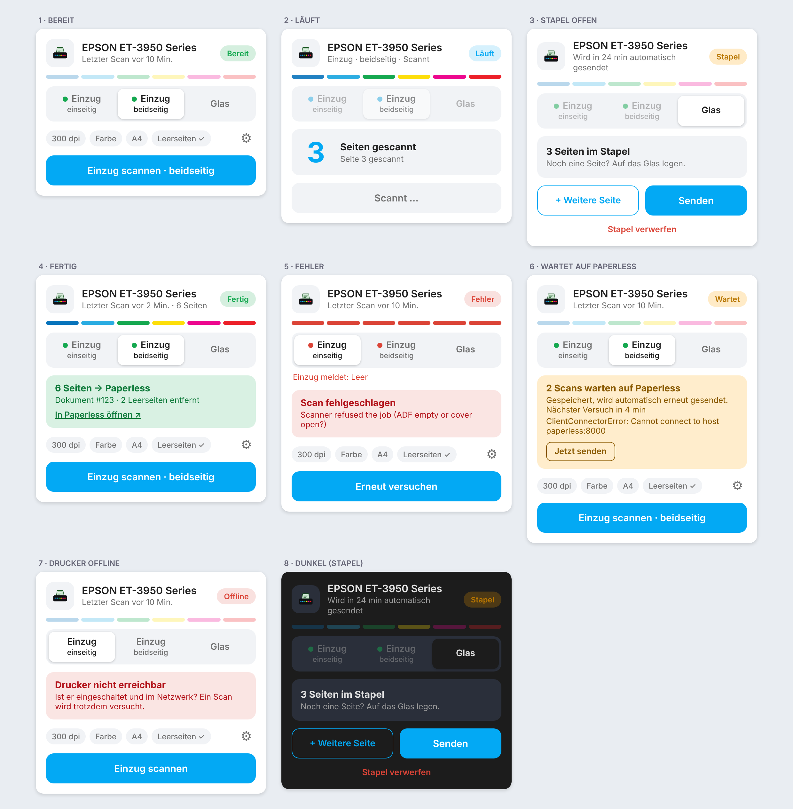

# Scan to Paperless – Home Assistant Integration

Scannt über das Netzwerk (eSCL/AirScan, z. B. Epson-Multifunktionsgeräte) und legt das Ergebnis als PDF in **Paperless-ngx** ab. Unabhängig vom Projekt Paperless-ngx; der Name beschreibt nur, wohin gescannt wird.

- Flachbett, Dokumenteneinzug (ADF) einseitig und beidseitig (Duplex)
- Mehrseitige ADF-Scans werden zu **einem** PDF zusammengefasst (JPEG ohne Neukodierung, A4 nach Scanfläche)
- Zeroconf-Erkennung (`_uscan._tcp` / `_uscans._tcp`) oder manuelle Einrichtung; HTTPS mit selbstsigniertem Zertifikat wird akzeptiert
- **Aufwärmlogik für den Einzug:** Meldet der Drucker nach dem Standby fälschlich `ScannerAdfEmpty`, wird bis zu 2× ein winziger Flachbett-Scan (100 dpi, 10×10 mm) gemacht, um den Sensor zu aktualisieren. Liefert ein Scan 0 Seiten, gibt es bis zu 3 Versuche mit Pause.
- Timeouts: Einzug 900 s, Flachbett 180 s; die Seitenzahl wird live aktualisiert
- Immer nur ein Scan gleichzeitig; der eSCL-Job wird danach sauber gelöscht
- **Flachbett arbeitet immer mit einem Stapel:** Der Button „Scan Flachbett“ legt die Seite in einen Zwischenspeicher. Beliebig oft wiederholen, dann „Stapel senden“ (ein PDF) oder „Stapel verwerfen“. Wird der Stapel länger als X Minuten (Standard 30) nicht angefasst, feuert das Event `ha_airscan_batch_stale` oder – per Option – er wird automatisch gesendet. Der Einzug scannt dagegen sofort und lädt direkt hoch. Der Service `ha_airscan.scan` mit `source: platen` sendet weiterhin sofort (für Automationen).
- Ziel „Datei“ (z. B. Paperless-Consume-Ordner): Schreiben über eine versteckte Temp-Datei mit anschließendem Umbenennen, damit Ordnerüberwachung nie halbe PDFs sieht; vorher Prüfung auf mindestens 256 MiB freien Speicher
- Grenzen: ein Scan oder Stapel darf höchstens 512 MiB groß sein; der Farbmodus wird gegen die Fähigkeiten der gewählten Quelle geprüft
- Diagnose-Download in HA (Geräte & Dienste → Integration → ⋮) ohne Token, URL, Host und Scanner-UUID
- **Leerseitenerkennung (optional, nur Einzug):** Entfernt leere Seiten, vor allem Rückseiten beim Duplex-Scan, vor dem PDF-Bau. Standardmäßig aus; Schalter und Schwelle in den Optionen, pro Aufruf per `skip_blank` überschreibbar. Gemessen wird der Tintenanteil im Seiteninneren (Rand wird ignoriert); schwaches Durchscheinen der Rückseite zählt nicht als Inhalt, eine ganz dunkle Seite nie als leer. Sind alle Seiten leer, schlägt der Scan mit einer Meldung fehl. Das Glas ist ausgenommen.
- **Papierformat** (Option, Standard A4; A5, Letter, Legal oder volle Scanfläche): Der Scanbereich wird auf das Format begrenzt. Ohne das scannt ein Legal-Einzug (z. B. Epson) A4-Blätter mit weißem Streifen unten.
- **Papierlage im Einzug** (Option: automatisch, links, Mitte, rechts): Liegt das Papier im Einzug an einer Seite an (beim Epson ET-3950 rechts), schneidet die Integration auch die Breite zu und lässt 15 Pixel Spielraum. Bei „automatisch“ wird die Ausrichtung des Scanners verwendet; meldet er keine, bleibt die volle Breite erhalten.
- **Status „Fertig“ heißt: Paperless hat das Dokument tatsächlich verarbeitet.** Nach dem Upload fragt die Integration die Paperless-Aufgabe ab (bis 2 Minuten). Lehnt Paperless ab (z. B. Duplikat), wird der Status `error` mit dem Grund aus Paperless. Dauert die Verarbeitung länger, bleibt es `done` mit dem Hinweis „Paperless verarbeitet noch“. Ein Token ohne Zugriff auf die Aufgabenliste funktioniert weiter, dann gilt der Upload als Erfolg.
- **Warteschlange bei Paperless-Ausfall:** Ist Paperless nicht erreichbar (oder der Token ungültig), geht der Scan **nicht verloren**: Das PDF wird im Ordner `config/ha_airscan_outbox/` gespeichert und automatisch mit wachsenden Abständen (1, 2, 5, 10, 15 min) erneut gesendet, auch nach einem Neustart von Home Assistant. Status `queued` („Wartet auf Paperless“), Sensor *Warteschlange* mit Anzahl und Fehlergrund, Knopf bzw. Service `ha_airscan.retry_queue` zum sofortigen Senden, Event `ha_airscan_queue_delivered`. Meldet Paperless beim erneuten Senden ein Duplikat (der erste Versuch kam doch an), gilt das als zugestellt. Lehnt Paperless ein Dokument endgültig ab, bleibt die Datei zur manuellen Bearbeitung im Ordner liegen und wird nicht weiter versucht.
- Dateiname `scan-YYYYMMDD-HHMMSS.pdf`

## Entitäten

| Entität | Beschreibung |
|---|---|
| Buttons | Scan Flachbett / Einzug (einseitig) / Einzug (beidseitig), Stapel senden / verwerfen |
| Sensor *Status* | `idle` (Bereit), `batch` (Stapel offen), `running` (Läuft), `done` (Fertig), `queued` (Wartet auf Paperless), `error` (Fehler); Attribute: `detail` (Klartext), `printer_online`, `printer_state`, `pages`, `batch_pages`, `source` (`platen`/`adf`/`adf_duplex`), `destination`, `document_id`, `blank_removed`, `finished_at` (des letzten Scans) |
| Sensor *Letzter Scan* | Zeitpunkt, an dem der letzte Scan abgeschlossen wurde (bleibt nach einem Neustart erhalten) |
| Sensor *Warteschlange* | Anzahl der Scans, die auf Paperless warten (Attribute: Fehlergrund, nächster Versuch) |
| Sensor *Seiten* | Seiten des laufenden/letzten Jobs bzw. des offenen Stapels |
| Sensor *Einzug* | `loaded`, `empty`, `processing` (während des Scans), `jam`, `cover_open`, `error` laut Drucker (`loaded`/`empty` kann nach Standby veraltet sein) |

Services: `ha_airscan.scan`, `ha_airscan.batch_add`, `ha_airscan.batch_send`, `ha_airscan.batch_discard`, `ha_airscan.retry_queue`. Events: `ha_airscan_scan_finished`, `ha_airscan_batch_stale`, `ha_airscan_queue_delivered`.

Fehler-Benachrichtigung per Automation auf den Statussensor:

```yaml
triggers:
  - trigger: state
    entity_id: sensor.epson_status
    to: error
actions:
  - action: notify.notify
    data:
      message: "Scan fehlgeschlagen: {{ state_attr('sensor.epson_status', 'detail') }}"
```

## Installation

**HACS (empfohlen):** HACS → ⋮ → *Benutzerdefinierte Repositories* → `https://github.com/ludgerbeckmann/ha_airscan`, Kategorie *Integration* → herunterladen → Home Assistant neu starten → *Einstellungen → Geräte & Dienste → Integration hinzufügen → „Scan to Paperless“*.

**Manuell:** `custom_components/ha_airscan` nach `config/custom_components/` kopieren und neu starten.

Die Domain lautet `ha_airscan`. Releases entstehen automatisch: Ein Merge nach `main` mit neuer `version` in der `manifest.json` erzeugt Tag `vX.Y.Z` und GitHub-Release (`.github/workflows/release.yml`), HACS zeigt dann das Update.

## Dashboard-Karte



Die Integration bringt eine eigene Karte mit, die Home Assistant automatisch lädt (nach dem Update einmal den Browser neu laden). Karte hinzufügen → *Scan to Paperless* wählen, oder per YAML:

```yaml
type: custom:ha-airscan-card
entity: sensor.epson_et_3950_series_status   # der Status-Sensor des Scanners
```

- Scanart in drei Segmenten wählen: **Einzug einseitig**, **Einzug beidseitig** (nur wenn der Scanner Duplex kann) oder **Glas**; über das Zahnrad Auflösung, Farbe, Format und Leerseiten **für den nächsten Scan** (wird im Browser gemerkt, die Integrationsoptionen bleiben unverändert). Die Punkte an den Einzug-Segmenten zeigen den Zustand des Einzugs; meldet er etwas anderes als „geladen“, steht es zusätzlich als Text darunter.
- Zeigt Status, laufende Seitenzahl, Einzugsstatus, den Stapel mit Restzeit, das Ergebnis mit Link zu Paperless und Fehlermeldungen. Farben und Schrift folgen dem Theme.
- **Drucker nicht erreichbar:** Antwortet der Drucker auf zwei Statusabfragen in Folge (alle 30 s) nicht, zeigt die Karte „Offline“ mit einem Hinweis. Der Scan-Knopf bleibt aktiv, denn ein Drucker im Standby wird beim Scan geweckt. Meldet der Drucker selbst einen Fehler (`Stopped`/`Down`), steht das ebenfalls dort. Während eines laufenden Scans wird nie gewarnt, weil der Drucker dann Abfragen oft verzögert beantwortet. Die Angaben stehen als Attribute `printer_online` und `printer_state` am Status-Sensor und lassen sich für Automationen nutzen.
- Optional: `name` (Titel) und `config_entry` (bei mehreren Scannern).
- Die Karte ruft nur die Services der Integration auf; ohne eigene Karte funktioniert weiterhin das Beispiel in [`examples/dashboard.yaml`](examples/dashboard.yaml) mit Standard-Karten.

## Paperless

In Paperless unter *Profil → API-Token* ein Token erzeugen. In den Integrationsoptionen URL, Token und optional Standard-Tags/Korrespondent/Dokumenttyp (numerische IDs) eintragen.

## Service-Beispiel

```yaml
action: ha_airscan.scan
data:
  source: adf
  duplex: true
  resolution: 300
  title: Post vom {{ now().strftime('%d.%m.') }}
  tags: "3,7"
```

Mit `destination: file` und `directory: /config/scans` wird stattdessen eine Datei geschrieben (Pfad muss in `allowlist_external_dirs` stehen).

## Hinweise

- Duplex wird per `<scan:Duplex>` angefordert und nur angeboten, wenn der Scanner `AdfDuplexInputCaps` meldet.
- Tipp: Dem Drucker eine DHCP-Reservierung geben; bei neuer IP aktualisiert die Zeroconf-Erkennung die Einrichtung.
- Nicht mit echter Hardware getestet (nur gegen einen simulierten eSCL-Server); bei Problemen bitte Modell und `http://<ip>/eSCL/ScannerCapabilities` in einem Issue anhängen.
