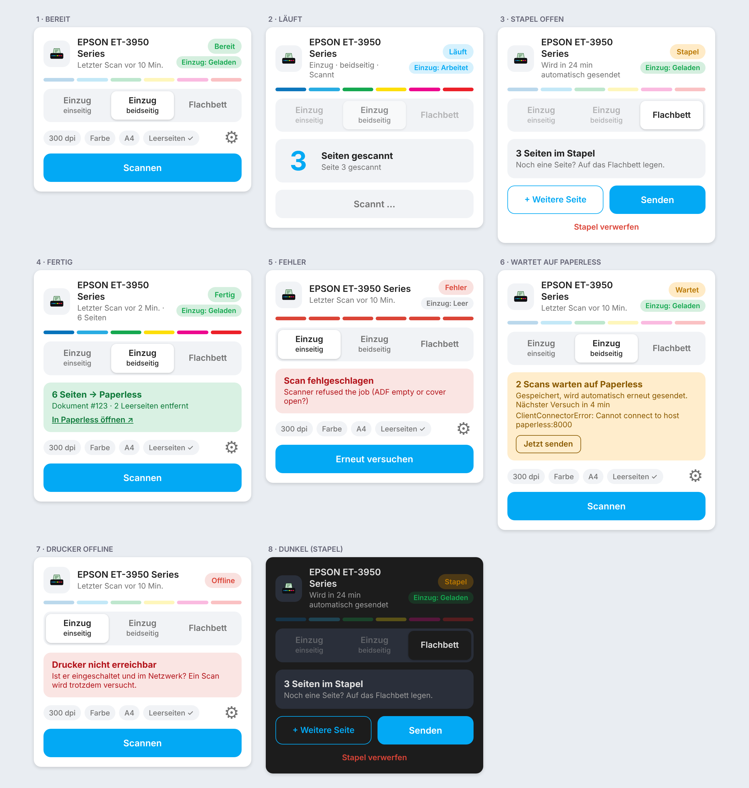

# Dashboard-Karte

Zurück zur [Übersicht](../README.md).



Die Integration bringt eine eigene Karte mit, die Home Assistant automatisch lädt (nach einem Update einmal den Browser neu laden). Karte hinzufügen → *Scan to Paperless* wählen, oder per YAML:

```yaml
type: custom:ha-airscan-card
entity: sensor.epson_et_3950_series_status   # der Status-Sensor deines Scanners
```

Optional: `name` (Titel) und `config_entry` (bei mehreren Scannern).

## Aufbau

Die Karte ändert ihre Größe nicht, egal in welchem Zustand sie ist.

- **Kopfzeile:** Gerätename und Zustand des Einzugs (geladen, leer, arbeitet, Papierstau …; er kann nach dem Standby veraltet sein).
- **Statusbereich:** ein Bereich mit Zustandsmarke, Überschrift und Detailtext: Scan läuft, Stapel offen (mit Restzeit), Ergebnis mit Link zu Paperless, wartende Scans mit „Jetzt senden“, Fehler, Hinweis „Leere Seite erkannt“, Drucker nicht erreichbar.
- **Scanart** in drei Segmenten: **Einzug einseitig**, **Einzug beidseitig** (nur wenn der Scanner Duplex kann) oder **Flachbett**.
- **Optionen** (Auflösung, Farbe, Format, Leerseiten) für den **nächsten Scan** über das Zahnrad; sie werden im Browser gemerkt, die Integrationsoptionen bleiben unverändert.
- **Knöpfe:** „Scannen“. Bei offenem Stapel stehen **+ Seite**, **Senden** und **Verwerfen** in einer Reihe, die Optionen sind abgeblendet.

Farben und Schrift folgen dem Theme.

## Drucker nicht erreichbar

Antwortet der Drucker auf zwei Statusabfragen in Folge (alle 30 s) nicht, zeigt die Karte „Offline“ mit einem Hinweis. Der Scan-Knopf bleibt aktiv, denn ein Drucker im Standby wird beim Scan geweckt. Meldet der Drucker selbst einen Fehler (`Stopped`/`Down`), steht das ebenfalls dort. Während eines laufenden Scans wird nie gewarnt, weil der Drucker dann Abfragen oft verzögert beantwortet. Die Angaben stehen als Attribute `printer_online` und `printer_state` am Status-Sensor und lassen sich für Automationen nutzen.

## Ohne eigene Karte

Mit Standard-Karten funktioniert das Beispiel in [`examples/dashboard.yaml`](../examples/dashboard.yaml).
